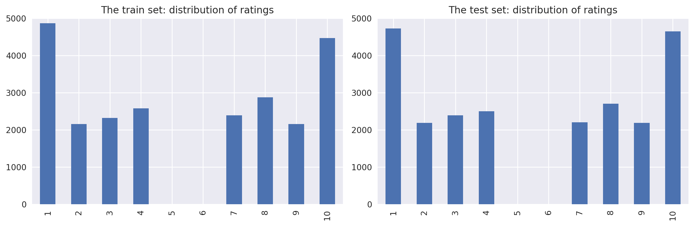
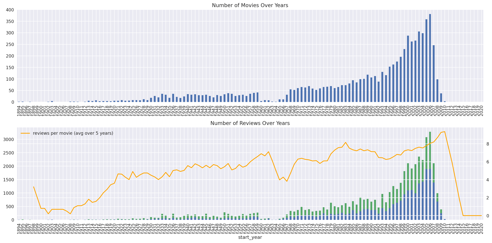
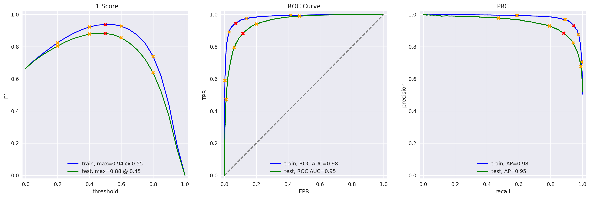

# Movie Review Sentiment

A sentiment classifier that flags negative movie reviews, built to see how far classic
bag of words modelling gets before a transformer becomes worth the compute.

**Best test F1 0.88** on 23,535 held out IMDB reviews, against a required 0.85. Two very
different models tie at that number, and the cheaper one wins.

## The problem

The Film Junky Union runs a community for classic movie fans and wants negative reviews
detected automatically so they can be filtered and routed. The brief was a model with an
F1 of at least 0.85 on the test split. The interesting question is not whether 0.85 is
reachable, it is how much machinery you have to buy to get there.

So I built four models at four price points and compared them on the same split.

## Results

| Model | Features | Classifier | Test F1 | Test ROC AUC | Train F1 |
| --- | --- | --- | --- | --- | --- |
| 0 | none, constant prediction | DummyClassifier | 0.00 | 0.50 | 0.00 |
| 1 | TF-IDF on normalized text, 71,531 terms | LogisticRegression | **0.88** | 0.95 | 0.94 |
| 3 | TF-IDF on spaCy lemmas, 59,139 terms | LogisticRegression | **0.88** | 0.95 | 0.93 |
| 4 | TF-IDF on spaCy lemmas, 59,139 terms | LightGBM, 500 trees | 0.87 | 0.95 | 1.00 |

### Lemmatization bought nothing

Model 1 runs on text that was only lowercased and stripped of everything that is not a
letter. Model 3 adds a full spaCy lemmatization pass over all 47,331 reviews and lands on
exactly the same test F1. That pass costs about seven minutes of compute and returns zero.
With tens of thousands of TF-IDF terms over 23,796 training documents, the vocabulary is
already wide enough that collapsing *watched* and *watching* into *watch* does not hand a
linear model information it was missing.

### Gradient boosting was the wrong tool for this feature space

Model 4 reached a training F1 of 1.00 and a test F1 of 0.87. That is a gap of 0.13, against
0.06 and 0.05 for the two logistic regressions. Five hundred trees on a sparse 59k
dimensional matrix memorize the training set. Sparse high dimensional text is the case
where a regularized linear model wins, and it fits in seconds instead of minutes.

### The data is balanced, which is why the baseline is worthless

49.9% of training reviews and 49.8% of test reviews are positive, so accuracy and F1 land
on the same number throughout and a constant prediction scores F1 0.00 with ROC AUC 0.50.
Everything above that is real signal.





## Where it breaks

I wrote eight reviews of my own and ran them through every model. The plain ones are easy
and all three agree. The mixed ones are where the method shows its limits.

| Review | Model 1 | Model 3 | Model 4 |
| --- | --- | --- | --- |
| Worst thing I have seen this year. Save your money. | 0.00 | 0.01 | 0.02 |
| A masterpiece. Every frame is deliberate. | 0.78 | 0.81 | 0.75 |
| The acting is wooden, the script is lazy, and somehow I still want to watch it again. | 0.06 | 0.05 | 0.12 |
| I wanted to hate this one and I could not. It is actually very good. | 0.32 | 0.31 | 0.61 |
| Not bad. I went in expecting nothing and came out still thinking about it. | 0.18 | 0.09 | 0.16 |

Probability that the review is positive. The last three are all positive or mixed in
intent and the models mostly call them negative. A bag of words sees *wooden* and *lazy*
and has no way to weigh the clause that reverses the verdict, and *not bad* is understatement
carried entirely by word order, which TF-IDF throws away.



## What this means in production

Strong on reviews that say what they mean, weak on sarcasm, negation and praise through
faint damnation. For a filter that flags reviews and sends them to a moderator, 0.88 is
good enough and the errors cost a few seconds of human attention each. For anything that
hides or deletes a review on its own, it is not good enough, and that is the case where
spending the compute on BERT is justified, because a transformer keeps word order and
context and handles exactly the clauses that break this approach.

**Recommended model: Model 1.** It ties the best test F1, trains in seconds, skips the
lemmatization pass entirely, and leaves the smallest preprocessing surface to maintain.

## Files

| File | What it does |
| --- | --- |
| `explore_reviews.py` | EDA. Writes four figures and `results/eda_summary.json`. |
| `train_sentiment_models.py` | Trains and evaluates all four models, scores the eight custom reviews, writes `results/results.json` and `results/custom_review_scores.csv`. |
| `results/results.json` | Run configuration and every metric. |
| `results/training_log.txt` | Full console output of the approved run. |
| `results/custom_review_scores.csv` | The eight custom reviews with each model's probability. |
| `figures/` | EDA charts and the threshold, ROC and precision recall panel for each model. |

## Running it

```bash
pip install -r requirements.txt
python -m spacy download en_core_web_sm

export IMDB_REVIEWS_PATH=/path/to/imdb_reviews.tsv
python explore_reviews.py
python train_sentiment_models.py
```

The dataset is the IMDB polarity set with 47,331 labelled reviews and a train and test
split that ships with the data. The path defaults to the location used on the TripleTen
platform, so set `IMDB_REVIEWS_PATH` if the file lives somewhere else.

## What I would do next

1. Deduplicate before training. There are 91 fully duplicated review texts in the set and
   they are not guaranteed to sit on the same side of the split.
2. Add bigrams to the vectorizer. *Not bad* and *not good* are currently the same two
   unigrams in different orders, and bigrams are the cheapest way to recover some of that.
3. Fine tune DistilBERT on a subset and compare against Model 1 on the same test split.
   The point is not a better headline number, it is finding out how much of the remaining
   error is the negation and sarcasm the linear model structurally cannot see.
